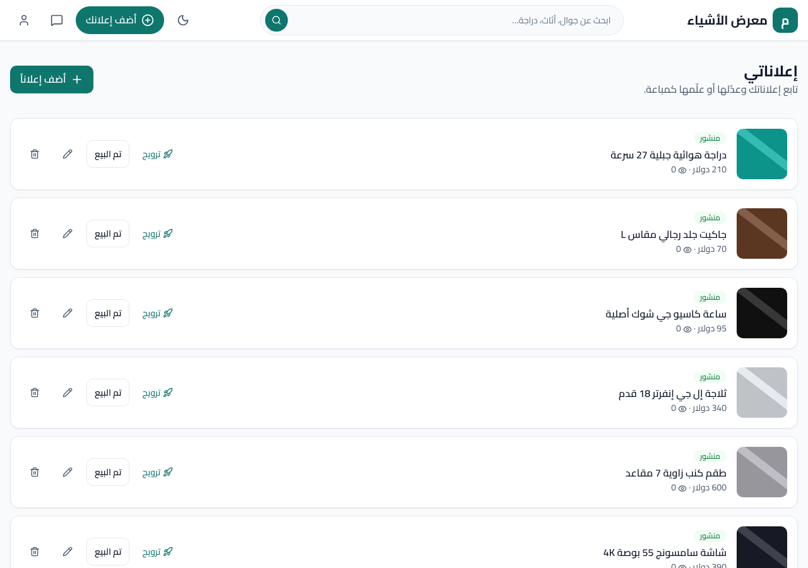
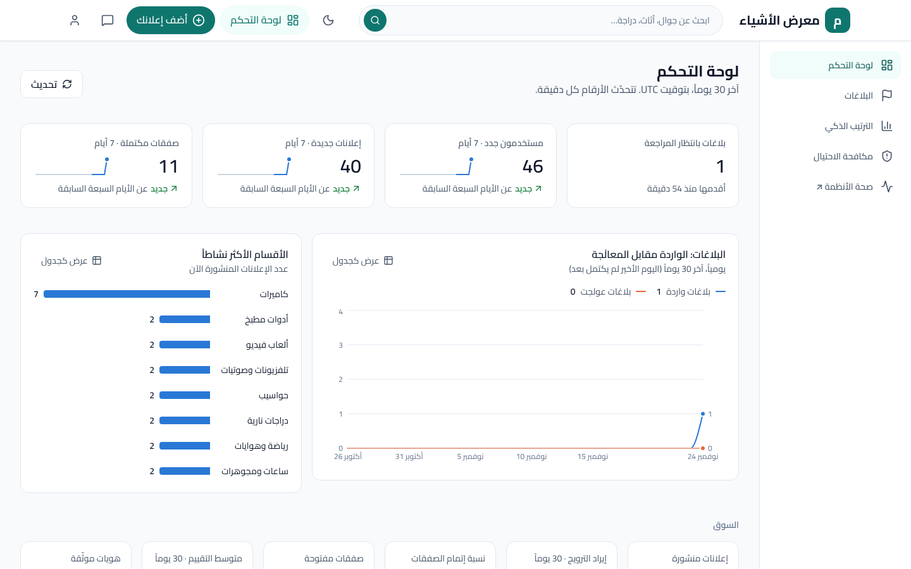
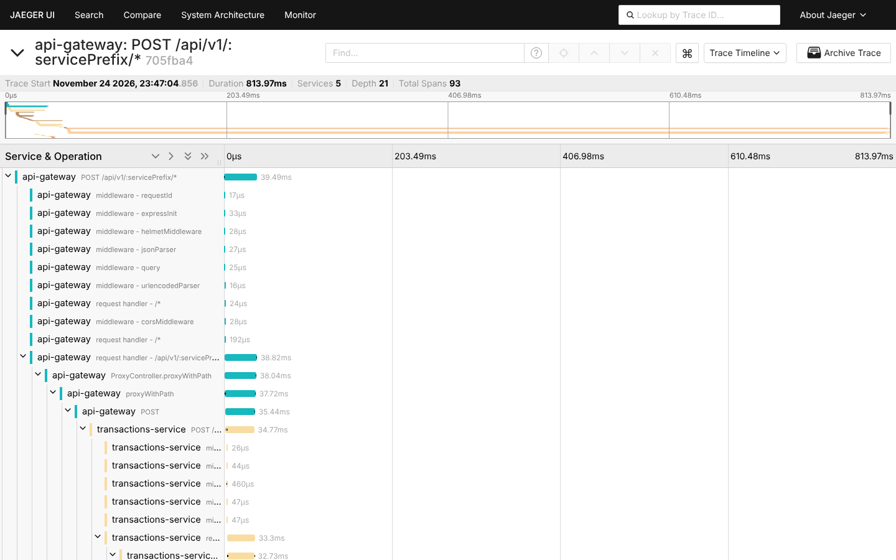
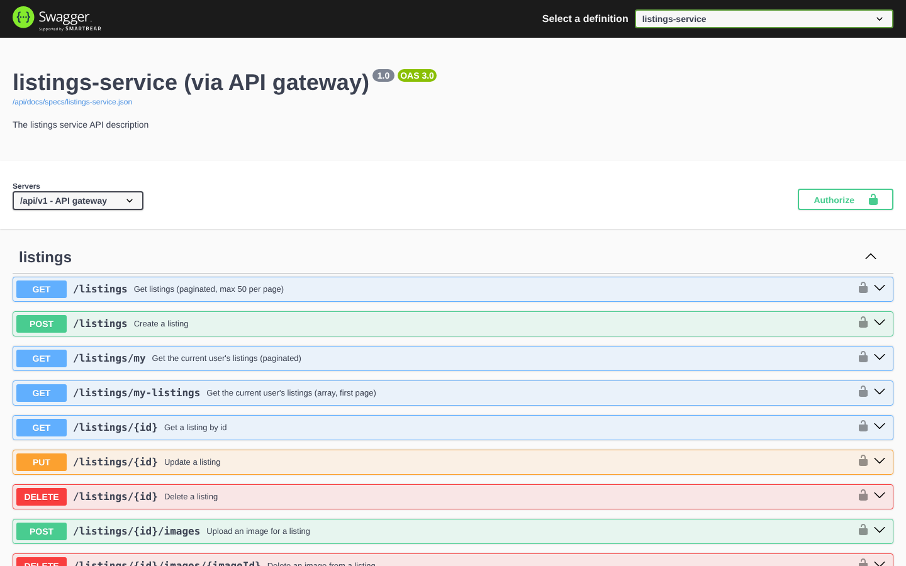
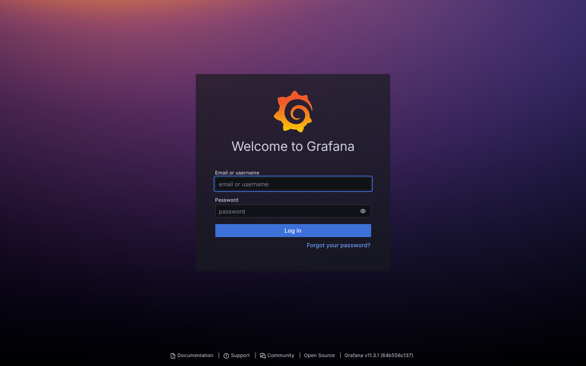

# Ma'rad Al-Ashya' — معرض الأشياء

**A production-shaped C2C marketplace built as 11 microservices** — NestJS (TypeScript) and FastAPI (Python)
behind an API gateway, with a Next.js web app and a Flutter mobile app. One command starts the whole
system locally, health-gated, with demo data, distributed tracing and dashboards.

[](.github/workflows/ci.yml)
[](.github/workflows/security.yml)



## Highlights

| | |
|---|---|
| **One command** | `make up` generates secrets and an RS256 key pair, builds 13 images, starts 19 long-running containers (plus a one-shot migration job) and waits until every health check passes. `make demo` tours the API. |
| **Security** | Asymmetric JWT (RS256 + JWKS, `kid`, `iss`/`aud`) — only auth-service can sign; refresh token in an `HttpOnly` cookie; DTO validation everywhere; gateway blocks internal routes; non-root, read-only containers. 0 HIGH/CRITICAL in `npm audit`, `pip-audit` and Trivy. [Audit →](docs/SECURITY_AUDIT.md) |
| **Observability** | JSON logs with `requestId` + `trace_id`; OpenTelemetry → Jaeger (one request = one trace across services); Prometheus + Grafana dashboards. |
| **Quality gates** | ~300 unit and integration tests, a 52-check end-to-end journey against the real stack in CI, lint with zero warnings, CodeQL, Trivy, gitleaks, Dependabot. |
| **Deploy-ready** | Helm chart: hardened pods, HPA, PDB, default-deny NetworkPolicy, ingress, migrations as a hook. [Deployment →](docs/DEPLOYMENT.md) |

## Architecture

```mermaid
graph LR
  subgraph Clients
    Web[Next.js web :3100]
    Mobile[Flutter app]
  end
  Web --> GW
  Mobile --> GW
  Web -. Socket.IO .-> MSG
  Mobile -. Socket.IO .-> MSG
  GW[API gateway :3000<br/>routing · rate limit · cache<br/>request id · unified OpenAPI]
  GW --> AUTH[auth<br/>signs RS256 tokens]
  GW --> LST[listings]
  GW --> SRCH[search<br/>ranking + A/B]
  GW --> MSG[messaging<br/>Socket.IO + Redis adapter]
  GW --> TRX[transactions<br/>FSM + reviews]
  GW --> IDN[identity<br/>KYC + KMS]
  GW --> USR[users]
  GW --> MOD[moderation<br/>Bull queue]
  GW --> FRD[fraud<br/>FastAPI + scikit-learn]
  GW --> PRS[personalization<br/>FastAPI]
  LST -->|index| SRCH
  LST & TRX --> FRD
  subgraph Data
    PG[(PostgreSQL 16)]
    RD[(Redis 7)]
    ES[(Elasticsearch 8)]
  end
  AUTH & LST & MSG & TRX & IDN & USR & MOD & FRD & PRS --> PG
  GW & AUTH & LST & SRCH & MSG & TRX & MOD & PRS --> RD
  SRCH & PRS --> ES
  subgraph Observability
    J[Jaeger] 
    P[Prometheus] --> G[Grafana]
  end
```

| Service | Stack | Responsibility |
|---|---|---|
| api-gateway | NestJS | Single entry point `/api/v1/*`: routing, rate limiting, short GET cache, internal-route blocking, request ids, aggregated Swagger |
| auth-service | NestJS + TypeORM | Register/login, OTP, Google/Facebook, RS256 access tokens, rotating refresh tokens, JWKS |
| listings-service | NestJS | Listings, categories, images (S3 or local), promotions (Stripe, optional), view counters |
| search-service | NestJS + Elasticsearch | Full-text/map search, smart ranking, sticky A/B experiment with click tracking |
| messaging-service | NestJS + Socket.IO | Real-time chat, read receipts, images, blocking; rooms shared across replicas via Redis |
| transactions-service | NestJS | Deal lifecycle (finite-state machine), two-way reviews, idempotency |
| identity-service | NestJS | KYC with Didit, documents encrypted with KMS (LocalStack locally), HMAC webhooks |
| users-service | NestJS | Profiles, notification settings, favorites |
| moderation-service | NestJS + Bull | Reports, automatic escalation, admin review |
| fraud-service | FastAPI + scikit-learn | Device fingerprints, transaction log, anomaly score (IsolationForest) |
| personalization-service | FastAPI | Partitioned event log, recommendations |
| web | Next.js 16 + Tailwind 4 | Buyer/seller journeys, chat, admin dashboard (Arabic, RTL, dark mode) |
| mobile | Flutter | Android/iOS app (`apps/mobile`) |

## Run it

Requirements: Docker with Compose v2, `make`, Node.js 20+ (for the seed/demo scripts).

```bash
make up      # secrets + key pair on first run, build, start, wait for health (~5 min first time)
make seed    # demo accounts and listings (idempotent)
make demo    # guided tour through the API
make e2e     # the 52-check end-to-end journey
make down    # stop (make clean also deletes the data volumes)
```

| URL | What |
|---|---|
| http://localhost:3100 | Web app — `seller@`, `buyer@`, `admin@demo.marad.local` / `Demo!Passw0rd` |
| http://localhost:3000/api/docs | Swagger for **every** service (dropdown) — requests go through the gateway |
| http://localhost:16686 | Jaeger traces |
| http://localhost:3200 | Grafana (`admin` / `GRAFANA_ADMIN_PASSWORD` in `infra/.env`) |
| http://localhost:9090 | Prometheus |

Behind a TLS-intercepting corporate proxy, set `EXTRA_CA_CERT=/path/ca.pem` in `infra/.env`: the CA is
mounted into image builds as a BuildKit secret and never stored in a layer.

### Example requests

```bash
API=http://localhost:3000/api/v1
TOKEN=$(curl -s $API/auth/login -H 'content-type: application/json' \
  -d '{"identifier":"seller@demo.marad.local","password":"Demo!Passw0rd"}' | jq -r .tokens.access_token)

curl -s "$API/listings?limit=5" | jq '.data[].title'                       # browse (public)
curl -s "$API/search?q=كاميرا&limit=5&session_id=me" | jq                 # ranked search, A/B variant
curl -s $API/listings -H "authorization: Bearer $TOKEN" -H 'content-type: application/json' \
  -d '{"title":"Road bike","description":"Like new","price":300}' | jq .id  # publish
curl -s $API/listings/not-a-uuid -H 'X-Request-ID: my-req-123'             # unified error with requestId
curl -s $API/auth/.well-known/jwks.json | jq                                # public verification keys
```

## Screenshots

| Admin dashboard | One request traced across 5 services |
|---|---|
|  |  |
| **Unified Swagger** | **Services dashboard** |
|  |  |

## Engineering notes

- **Security model** — [SECURITY_AUDIT.md](docs/SECURITY_AUDIT.md): findings, OWASP API Top 10 mapping and fix status.
- **Decisions** — [DECISIONS.md](docs/DECISIONS.md): ADRs with scored alternatives and the strongest objection to each choice
  (e.g. RS256 + JWKS vs shared HMAC, HttpOnly cookie vs BFF, overrides vs a NestJS major upgrade).
- **History** — [PROGRESS_LOG.md](docs/PROGRESS_LOG.md) and [FINAL_REPORT.md](docs/FINAL_REPORT.md).
- **Shared code** is copied into each service (each image builds from its own context) and kept byte-identical
  by `scripts/check-shared-copies.mjs` in CI; client/server route contracts are checked by `scripts/check-contracts.mjs`.

## Repository layout

```
apps/web            Next.js web app             services/*        11 services (9 NestJS, 2 FastAPI)
apps/mobile         Flutter app                 db/migrations     one migration history + runner
infra/              compose, Dockerfiles, Helm, monitoring config, k6 load tests
scripts/            gen-env, seed, demo, e2e smoke, CI guards
docs/               audit, ADRs, roadmap, deployment, progress log
```

---

### بالعربية

منصة سوق C2C (على غرار OLX) مبنية من 11 خدمة مصغرة (NestJS وFastAPI) خلف بوابة API، مع موقع Next.js وتطبيق Flutter.
التشغيل بأمر واحد `make up`، ثم `make seed` و`make demo`. التوثيق الكامل بالعربية في مجلد [`docs/`](docs/) —
ابدأ بـ [PROJECT_STATE.md](docs/PROJECT_STATE.md) و[FINAL_REPORT.md](docs/FINAL_REPORT.md).

> المشروع خاص — جميع الحقوق محفوظة.
